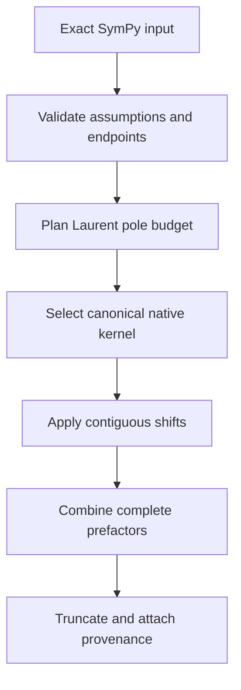

# Native expansion pipeline

Canonical kernels use strict nested sums, colored sums or rationalized HPL
systems. Numerical evaluation is a separate API and is never silently used as
an exact expansion backend. Unsupported cases fail explicitly.
