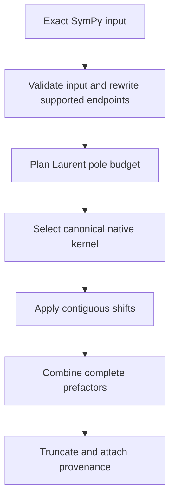

# Native expansion pipeline

Canonical kernels use strict nested sums, colored sums or rationalized HPL
systems. Termination, Gauss summation and excess-raising rewrites run before
Laurent planning, which accounts for any poles in their prefactors.
Higher-rank unit endpoints with positive base excess use exact limits of
the complete Laurent coefficients. See the [endpoint algorithms](endpoints.md).
