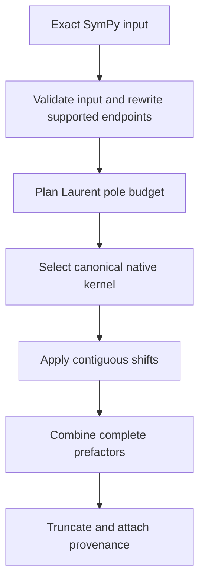

# Native expansion pipeline

Canonical kernels use strict nested sums, colored sums or rationalized HPL
systems. Termination, Gauss summation and excess-raising rewrites run before
Laurent planning, which accounts for any poles in their prefactors.
Higher-rank unit endpoints with positive base excess use exact limits of
the complete Laurent coefficients. See the [endpoint algorithms](endpoints.md).

## Package layout

- `hypra.cli` assembles the Typer application. `CliApplication` handles
  invocation, `Commands` connects Typer to the Python API, and
  `ExpansionRequest` reads exact JSON input.
- `hypra.native` contains the native backend and configuration, Laurent
  planning, parameter reductions, and the optional timeout worker. Atom
  dispatch lives in `hypra.native.atom`.
- `hypra.hpl` contains harmonic polylogarithm algebra, argument maps, endpoint
  reductions, and numerical evaluation.
- `hypra.api`, `hypra.symbolic`, and `hypra.serialization` provide the public
  expansion interface, symbolic types, and exact transport format.

For library code, use the [top-level Python API](python-api.md). For example,
`from hypra import evaluate_hpl` remains available; the implementation now
lives in `hypra.hpl.numeric`.
